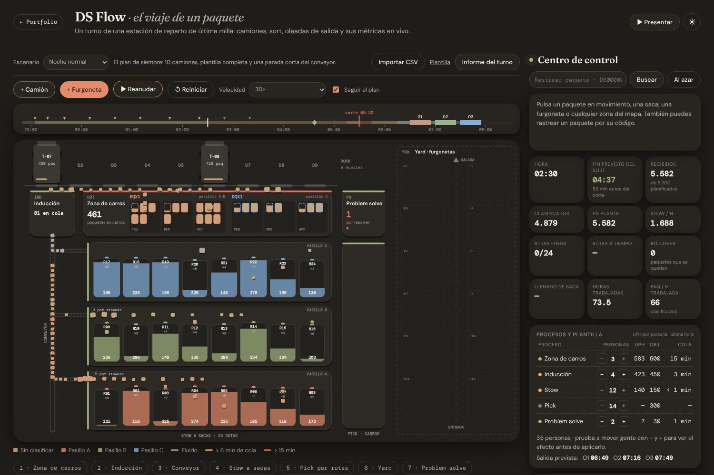
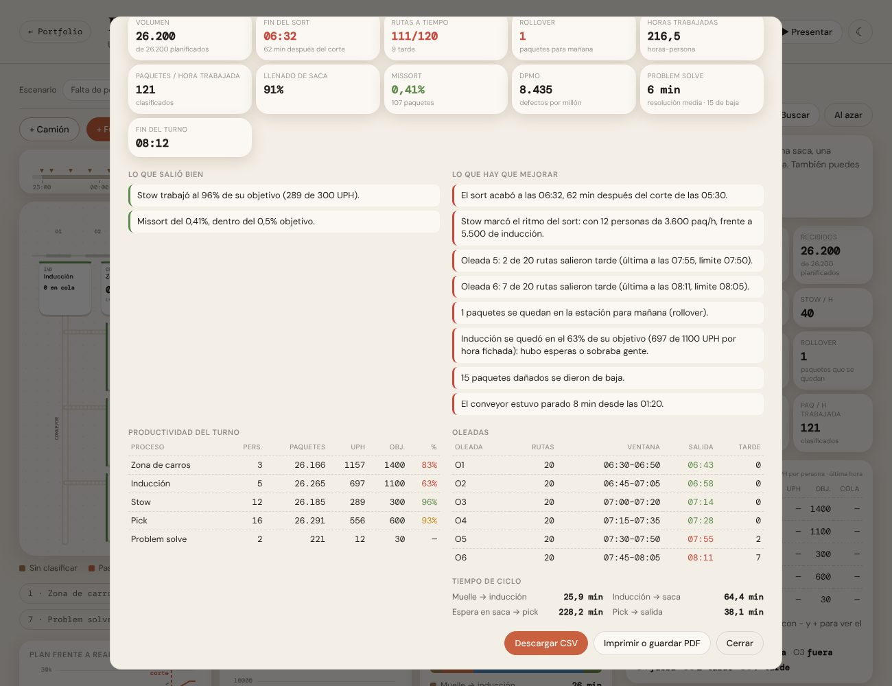
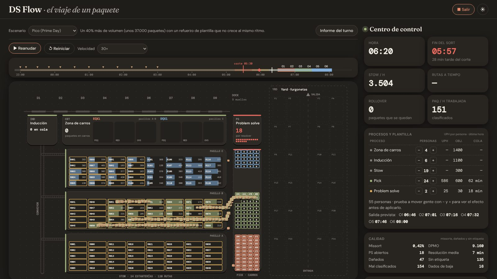
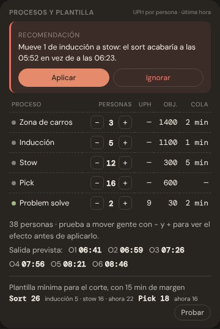
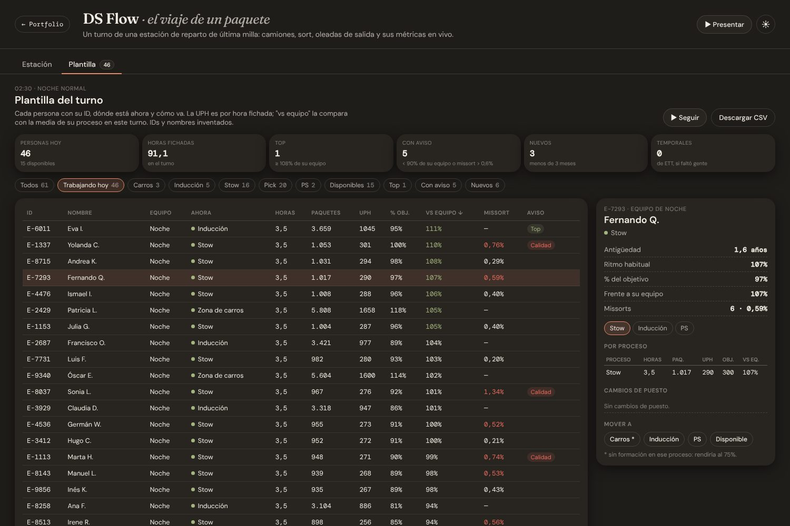

# DS Flow · el viaje de un paquete

Simulación de un turno de noche en una estación de reparto de última milla, del primer camión a la última furgoneta: unos 26.000 paquetes, 26 personas en el sort, 120 rutas en 24 estanterías y 6 oleadas de salida. Se ve cómo se mueve cada paquete por el plano y, a la vez, las métricas con las que se lleva una estación de verdad: hora prevista de fin del sort, rutas a tiempo, productividad por proceso, calidad y un informe al acabar el turno.

**Demo:** https://jorgeoliver7.github.io/ds-flow/

Forma parte del [portfolio de Jorge Acedo](https://jorgeoliver7.github.io/Portfolio-Website/).



## Cómo contar un turno con la app

1. **Elige un escenario** arriba a la izquierda: noche normal, pico, falta de personal, camión retrasado o tarde (PM), el turno de same day con unos 500 paquetes que salen a las 18:00. Cada uno tiene su semilla, así que sale igual cada vez. También se puede enlazar directamente con `?escenario=pico`.
2. **Sube la velocidad** a 180× o 600× para ver el turno entero en unos minutos.
3. **Sigue la barra del turno**: camiones del plan (▼), corte del sort, oleadas de salida y el rombo con la hora prevista de fin del sort, en verde si llega al corte y en rojo si no.
4. **Prueba el planificador** en "Procesos y plantilla": mueve personas con − y + y verás la nueva hora de fin y las rutas que saldrían tarde antes de aplicar el cambio. Debajo está la **plantilla mínima** para llegar al corte con 15 min de margen y sacar todas las oleadas; "Probar" la carga en el planificador.
5. **Sigue las recomendaciones**: durante el turno la app avisa como lo haría un responsable de turno ("Mueve 1 de inducción a stow: el sort acabaría a las 05:52 en vez de a las 06:23"). Se aplican con un clic y quedan en la actividad.
6. **Mira la pestaña "Plantilla"**: cada persona del turno con un ID y un nombre inventados, su equipo (noche, mañana o tarde), dónde está ahora, horas, paquetes, UPH, % del objetivo, comparación con la media de su proceso y missorts. Marca a los mejores y a quien necesita seguimiento, permite mover a alguien de proceso y se descarga en CSV.
7. **Al acabar se abre el informe** con lo que salió bien y lo que hay que mejorar, y compara la plantilla con la que se empezó con la mínima para ese volumen. Se puede descargar en CSV o guardar como PDF.



**Modo presentación** (botón "Presentar" o tecla <kbd>P</kbd>): pantalla completa con el plano y los KPIs principales. La barra espaciadora pausa.



## Qué significa cada métrica

| Métrica | Qué mide |
| --- | --- |
| Fin previsto del sort | Hora a la que quedaría todo clasificado en sacas al ritmo de la plantilla actual. Simula minuto a minuto lo que queda: los camiones pendientes entran al ritmo de descarga desde su llegada y el proceso más lento (inducción o stow) va vaciando lo acumulado. |
| Corte del sort | Hora límite para tener todo clasificado antes de empezar a cargar. |
| Rutas a tiempo | Furgonetas que salen dentro de la ventana de su oleada. |
| Rollover | Paquetes que siguen en la estación cuando su ruta ya ha salido: se quedan para el día siguiente. |
| UPH | Paquetes por hora y persona. En el panel es la última hora; en el informe, todo el turno entre las horas fichadas, así que las esperas también cuentan. |
| Paq / h trabajada | Paquetes clasificados entre todas las horas-persona del turno. |
| Llenado de saca | Ocupación media de las sacas de las rutas que ya han salido. |
| Missort | Paquetes que acaban en una saca que no es la suya. Se detectan en pick y vuelven por problem solve. |
| DPMO | Defectos (dañados, sin etiqueta y missorts) por millón de paquetes recibidos. |
| Problem solve | Paquetes en revisión y su tiempo medio de resolución. Los dañados sin arreglo se dan de baja. |
| Plantilla mínima | Personas por proceso con las que el sort acaba 15 min antes del corte y salen todas las oleadas. Se calcula con un modelo de flujo: los camiones entran al ritmo de descarga y el sort los vacía al 95% de su ritmo nominal, que es lo que rinde de media una noche. |
| vs equipo | UPH de una persona frente a la media de las demás de su proceso en el mismo turno. Como la UPH es por hora fichada, las esperas bajan a todo el equipo; compararse con el equipo aísla el ritmo de cada uno. Por debajo del 90% sale como aviso, desde el 108% como top. |
| Tiempo de ciclo | Minutos medios de cada tramo: muelle → inducción → saca → pick → salida. |





## Importar una noche concreta

"Importar CSV" carga camiones, volumen por ruta, hora de corte y oleadas desde un archivo como [`ejemplo-turno.csv`](ejemplo-turno.csv):

```
tipo;id;hora;paquetes
camion;T-01;23:00;700
ruta;R01;;420
corte;;05:30;
oleada;A;06:20;
```

El archivo **se lee en el navegador y no se sube a ningún sitio**. El `.gitignore` deja fuera cualquier otro CSV para que no acabe en el repositorio por error.

## Datos

La estación es genérica. Muelles, pasillos, rutas, horarios, ritmos y volúmenes son cifras inventadas o redondeadas, y se ajustan en [`layout.js`](layout.js). Las personas de la plantilla, sus IDs y sus nombres también son inventados. No contiene datos internos de ninguna empresa.

## Stack

JavaScript sin dependencias y Canvas. Sin build: es una página estática.

| Archivo | Qué hace |
| --- | --- |
| `index.html` | Estructura de la página y controles |
| `ds-flow.css` | Estilos, tema claro y oscuro, modo presentación e impresión del informe |
| `layout.js` | Geometría de la estación, objetivos de UPH, calidad y plan del turno |
| `engine.js` | Motor de la simulación y métricas, sin DOM (se prueba en Node) |
| `crew.js` | Plantilla con nombre: personas, habilidades, quién trabaja en cada proceso y sus métricas |
| `crewui.js` | Pestaña de plantilla |
| `scenarios.js` | Escenarios de la demo, cada uno con su semilla |
| `report.js` | Informe de fin de turno y exportación a CSV |
| `importcsv.js` | Lectura del CSV de una noche |
| `render.js` | Dibujo del plano en Canvas |
| `charts.js` | Gráficas pequeñas (plan frente a real, ritmo por hora) |
| `ui.js` | Centro de control, planificador, controles y bucle de animación |
| `test/` | Pruebas del motor (`npm test`) |

## Ejecutar en local

```bash
python3 -m http.server 8000
# abre http://localhost:8000
```

## Tests

```bash
npm test   # node --test, sin dependencias
```

Comprueban que no se pierde ningún paquete, que la misma semilla da la misma partida, que el turno se completa, que la previsión se acerca a la hora real, el planificador, las incidencias, los escenarios y la importación del CSV. Se ejecutan en cada PR con GitHub Actions.

## Despliegue

GitHub Pages desde la rama `main` (carpeta raíz).
